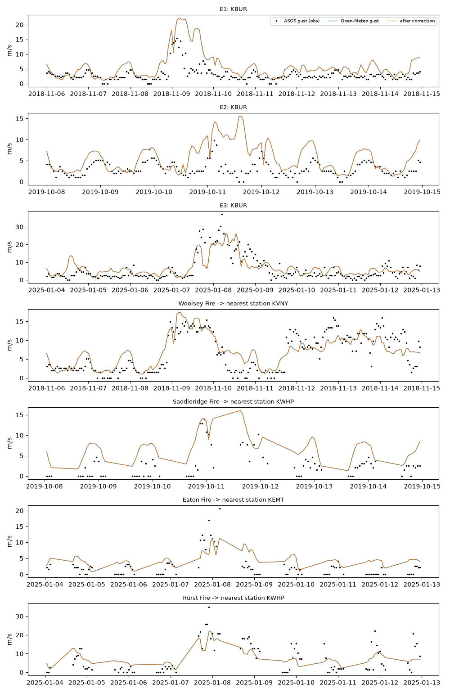
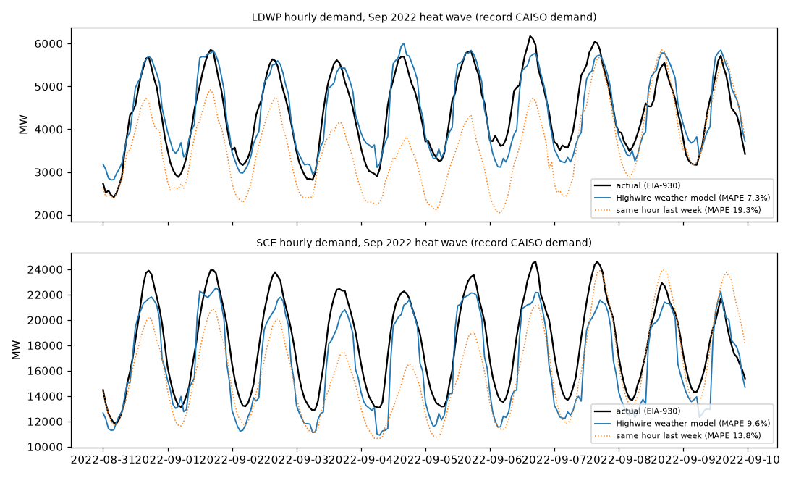
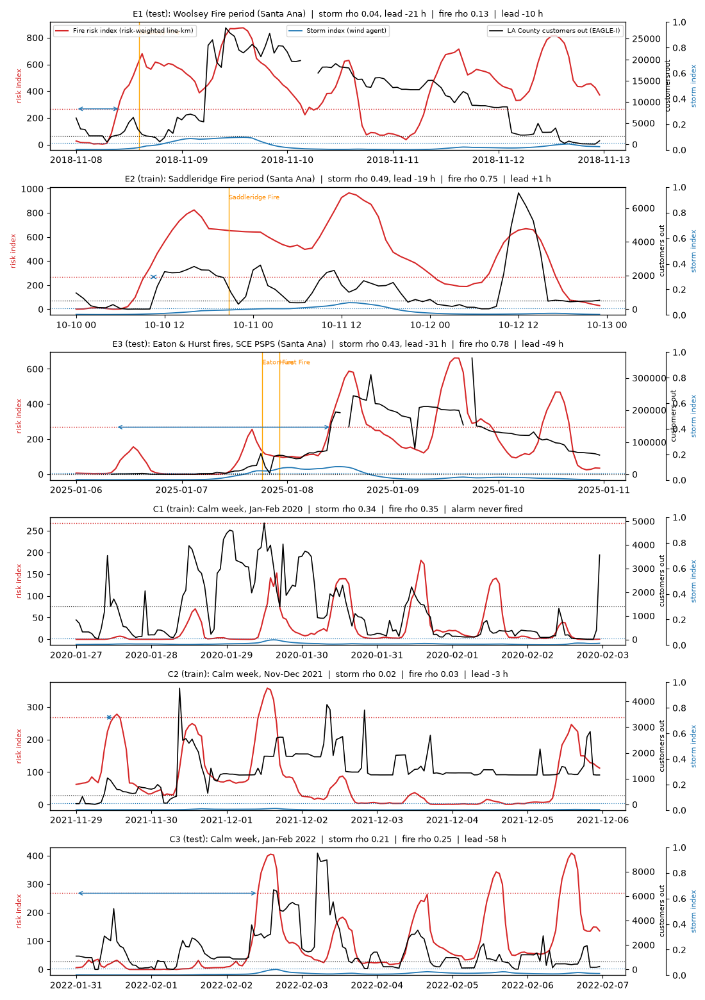

# Highwire: historical validation report (Greater Los Angeles)

_Generated 2026-11-14 17:40 UTC by `validation/run_all.py`. Every number below is read from `validation/results/*.json`._

**Split (written before any run, `validation/config.yaml`):** train E2, H1, C1, C2; test E1, E3, H2, C3. Multi-year series: calibrate 2019-2021, report 2022-2024.

**Modeled, not utility data:** line ratings, impedances, conductors, tower heights and load allocation are estimated from voltage class and 2020 Census population (see `data/processed/grid_report.md`).

## Scorecard

| Check | Result | Baseline | Status |
|---|---|---|---|
| V1 Thermal model vs reference | Max abs. error 0.00 C over 600 cases | linerate IEEE 738; CIGRE TB 601 Ex. B ampacity 1505 A vs published 1504 A | pass |
| V2 Weather inputs vs ground stations | Wind agent (live-station nudging): test gust RMSE 3.4 -> 2.5 m/s, bias +2.1 -> +0.7 | Raw reanalysis; windy hours (>= 12 m/s) RMSE 5.9 -> 5.3, bias -3.7 -> -3.3 | mixed |
| V3 Demand model vs actual (H2 heat wave) | Peak within 8.4% (SCE) / 2.7% (LDWP); MAPE 9.6% / 7.3% | Same hour last week: MAPE 13.8% / 19.3%, peak error 2.7% / 5.2% | mixed |
| V4a Grid stress vs actual outages (event replay) | Storm index: E1 Spearman 0.04, lead -21 h; E3 Spearman 0.43, lead -31 h | Fire index: E1 0.13 / lead -10 h, E3 0.78 / lead -49 h; calm week C3 storm alarm on 0.0% of hours | mixed |
| V4b Discrimination over 2022-2024 | Storm index AUC 0.81 (fire index 0.62) | Max gust alone AUC 0.82 | mixed |
| V5 Ignition hindcast | Woolsey Fire top 1%; Eaton Fire top 10%; Hurst Fire top 5% | Gust-only: Woolsey Fire top 4%; Eaton Fire top 1%; Hurst Fire top 3%; random: top 50% | small-sample |
| V6 De-energization vs SCE PSPS (E3, county level) | County overlap 3/4 (Jaccard 0.75) | No meaningful baseline at county level | weak |
| V7 Red Flag consistency | 95% of high-risk line-hours inside a Red Flag Warning | 28% of Red Flag zone-hours contain a high-risk line | pass |
| V8 Prediction from archived forecasts (no hindsight) | 2024 day-ahead storm AUC 0.80; E3 day-1 ignitions: Eaton Fire top 6% (gust-only 2%); Hurst Fire top 3% (gust-only 0%) | Day-ahead forecast gust alone AUC 0.86 | mixed |

## Calibration (training data only)

- **Gust correction:** candidate per-zone linear maps were fit on windy training hours, but none lowered training windy-hour RMSE (identity 3.69 m/s vs candidate 5.88 m/s in the valley), so no correction is applied: a = {'coast': 0.0, 'basin': 0.0, 'valley': 0.0, 'mountain': 0.0}, b = {'coast': 1.0, 'basin': 1.0, 'valley': 1.0, 'mountain': 1.0}.
- **Fire thresholds:** g50 = 6 m/s, h50 = 10% RH, c50 = 5 m; region alarm = 268 risk-weighted line-km (98th pct of training control weeks); line alarm = 0.30. Training hit rate 91% on 43 outage-spike hours, AUC 0.95. The optimum sits at the low edge of the search grid for g50 and h50 and the objective is flat there: on training data, very dry air (RH under ~10%) carries most of the signal.
- **Wind-pressure fire model (v4, tested, opt-in):** the legacy score with its saturating wind sigmoid replaced by (gust / 30 m/s)^2. Training hit rate 84% / AUC 0.941 (legacy 91% / 0.949); fitted humidity half-point 10%. Held-out: V5 Woolsey Fire top 0%; Eaton Fire top 4%; Hurst Fire top 11%. It tells strong gusts from breezes, but does not rank the ignition lines better while the humidity half-point is fit on one dry training fire, so it is not the default (`validation/config.yaml: fire_model: wind_pressure` to switch). Full results: `validation/results/wind_pressure_v4/`. The form was chosen after an audit looked at the test ignitions, so it is not a held-out result either way.
- **Two-step fire model (tested, not used):** P(fault) from the storm model x P(ignition | RH, LANDFIRE fuel). It passed the pre-set training rule (training AUC 0.945 vs legacy 0.949), but on held-out data it did worse: V5 Woolsey Fire top 5%; Eaton Fire top 9%; Hurst Fire top 23%; V6 County overlap 0/4 (Jaccard 0.00); V7 99% of high-risk line-hours inside a Red Flag Warning (recall 8% of Red Flag zone-hours contain a high-risk line). v3 therefore kept the legacy fire score instead (`validation/config.yaml: fire_model`). **That choice was made after seeing test results, so V5-V7 are no longer fully held-out for the fire-model choice.** Full two-step results: `validation/results/two_step_v3/`.
- **Load model:** training MAPE LDWP 6.1%, SCE 5.9% (2019-2021). v2 adds temperature x time-of-day terms and an inland-heat term, chosen on an internal 2019-20 fit / summer-2021 holdout before H2 was looked at.
- **Storm-damage model (wind agent), 2019-2021 only:** damage onset 10 m/s gust, restoration time constant 6 h, rain stock accepted (tau 6 h); alarm 0.052 (98th pct of non-outage hours). Leave-one-year-out AUC 0.794 vs gust-only 0.776. 23 candidates were compared in that protocol (plus ~60 exploratory variants, also on 2019-2021 only, while designing it), so expect some optimism.
- **Station nudging (wind agent):** residual length 20 km, shrinkage 1.0, chosen leave-one-station-out on training events. Quantile-mapping the reanalysis to 2019-2021 station climatology was also tried and rejected (worse on windy test hours).

## V1. Thermal model vs reference implementation

**What we tested.** Our numpy IEEE 738 steady-state solver against Statnett's `linerate` (IEEE738 model), plus the published CIGRE TB 601 Example B and IEEE 738 Annex B values.

**Data.** [linerate (Statnett)](https://github.com/statnett/linerate); CIGRE TB 601 Annex E; IEEE 738 Annex B.

**Result.**

- Sweep: 600 cases (current 100-1300 A, wind 0.2-10 m/s, ambient -5..45 C, altitude 0-1800 m, 30/90 deg): max |difference| 0.000 C (tolerance 2 C) -> PASS.
- CIGRE TB 601 Example B via linerate: ampacity 1505 A vs published 1504 A (0.07%); convective 172.2 vs 172.1 W/m; radiative 54.1 vs 54 W/m.
- Our IEEE 738 on the same Example B inputs: 1515 A (different standard; informational).
- IEEE 738 Annex B convection at 100.7 C: ours 83.01 W/m vs published 83.06 W/m.

**Baseline.** The reference implementation and the published worked examples.

**What it does and doesn't prove.** Our heat-balance code matches the reference library and the published worked examples. That shows correct implementation, not real-world accuracy.

## V2. Weather inputs vs ground stations

**What we tested.** Hourly Open-Meteo values bilinearly interpolated to 8 ASOS stations in the bbox (KPMD is outside and excluded), per event.

**Data.** [Open-Meteo Historical Weather](https://open-meteo.com/en/docs/historical-weather-api), [IEM ASOS](https://mesonet.agron.iastate.edu/request/download.phtml). Station gust = max(reported gust, sustained wind) within the hour; gusts above 45 m/s dropped as QC.

**Result.**

- Test events, all hours: gust bias +2.06 m/s, RMSE 3.43 m/s (n=6869); temperature RMSE 2.08 C; sustained wind RMSE 2.00 m/s.
- Test events, windy hours (station gust >= 12 m/s, n=280): bias -3.67 m/s, RMSE 5.87 m/s. After correction: identical (no correction was accepted in training).
- Wind agent, live-station nudging (leave-one-station-out): all hours bias +2.06 -> +0.74 m/s, RMSE 3.43 -> 2.52; windy hours bias -3.67 -> -3.30, RMSE 5.87 -> 5.27; per-station event peak bias -1.36 -> -2.00.
- Note: 'windy hours' are selected on the observed gust, which biases any noisy estimate low (regression to the mean); the all-hours and event-peak numbers are not affected by that.
- E1 (test): peak station gust 15.9 m/s vs peak gridded gust 22.2 m/s.
- E2 (train): peak station gust 14.9 m/s vs peak gridded gust 16.0 m/s.
- E3 (test): peak station gust 37.0 m/s vs peak gridded gust 26.1 m/s.
- H1 (train): peak station gust 9.8 m/s vs peak gridded gust 14.4 m/s.
- H2 (test): peak station gust 19.5 m/s vs peak gridded gust 17.1 m/s.
- C1 (train): peak station gust 21.1 m/s vs peak gridded gust 23.0 m/s.
- C2 (train): peak station gust 11.3 m/s vs peak gridded gust 10.2 m/s.
- C3 (test): peak station gust 16.5 m/s vs peak gridded gust 11.9 m/s.

**Baseline.** Raw reanalysis before correction.

**What it does and doesn't prove.** Spreading live airport-station errors to nearby lines (tested leave-one-station-out, so no station grades itself) removes most of the everyday gust bias; the strongest, very local Santa Ana gusts are still underestimated.

## V3. Demand model vs actual load (H2, test)

**What we tested.** Hourly demand predicted from population-weighted temperature (piecewise linear cooling/heating terms, 24 h mean) plus hour-of-day x weekend terms, temperature x time-of-day interactions (air conditioning matters most in the afternoon) and an inland-heat term (90th-percentile grid temperature), fit 2019-2021, applied to Aug 31 - Sep 9 2022.

**Data.** [EIA-930](https://www.eia.gov/electricity/gridmonitor/about) (LDWP BA, CAISO SCE sub-BA), [Open-Meteo Historical Weather](https://open-meteo.com/en/docs/historical-weather-api).

**Result.**

- SCE: peak 22534 MW predicted vs 24595 MW actual (-8.4%), peak-hour error -142 h, MAPE 9.6%.
- LDWP: peak 6004 vs 6170 MW (-2.7%), peak-hour error -47 h, MAPE 7.3%.

**Baseline.** Same hour last week: SCE MAPE 13.8% / peak -2.7%; LDWP MAPE 19.3% / peak -5.2%.

**What it does and doesn't prove.** Weather-only demand (heat x time-of-day + inland heat, fit 2019-2021) tracks the record heat wave hour by hour better than persistence; it still misses the record peak by more than persistence for SCE.

## V4a. Grid stress vs actual outages (event replay)

**What we tested.** Hourly region risk index (sum over tower points of fire risk x span km) from a full hindcast (power flow, IEEE 738, sag, blowout, clearance) vs LA County customers out. Lead time = first hour the index crosses its calibrated alarm to the first of 3 consecutive hours with outages above 2x the 2-day pre-event median (positive = the model was early).

**Data.** [EAGLE-I outages 2014-2025 (figshare)](https://figshare.com/articles/dataset/24237376) (hourly median of 15-min runs; LA County readings > 1 M dropped as QC), [Open-Meteo Historical Weather](https://open-meteo.com/en/docs/historical-weather-api), [EIA-930](https://www.eia.gov/electricity/gridmonitor/about).

**Result.**

- E1 (test, wind): Spearman 0.13 (4 counties 0.13); first alarm 2018-11-08 18:00:00+00:00; first sustained outage spike 2018-11-08 08:00:00+00:00; lead -10 h (single-hour spike definition: -10 h); alarm on 77.5% of hours; LA County peak 27534 customers out. _Exploratory (post-hoc): lead to the main surge (first hour >= 50% of peak, 2018-11-09 14:00:00+00:00) 20 h._
- E1 storm index (wind agent): Spearman 0.04; first alarm 2018-11-09 05:00:00+00:00; lead -21 h; alarm on 19.2% of hours; peak 0.10 (alarm 0.05).
- E2 (train, wind): Spearman 0.75 (4 counties 0.64); first alarm 2019-10-10 17:00:00+00:00; first sustained outage spike 2019-10-10 18:00:00+00:00; lead 1 h (single-hour spike definition: -10 h); alarm on 68.1% of hours; LA County peak 6896 customers out. _Exploratory (post-hoc): lead to the main surge (first hour >= 50% of peak, 2019-10-12 18:00:00+00:00) 49 h._
- E2 storm index (wind agent): Spearman 0.49; first alarm 2019-10-11 13:00:00+00:00; lead -19 h; alarm on 18.1% of hours; peak 0.10 (alarm 0.05).
- E3 (test, wind): Spearman 0.78 (4 counties 0.82); first alarm 2025-01-08 18:00:00+00:00; first sustained outage spike 2025-01-06 17:00:00+00:00; lead -49 h (single-hour spike definition: -49 h); alarm on 25.0% of hours; LA County peak 362313 customers out. _Exploratory (post-hoc): lead to the main surge (first hour >= 50% of peak, 2025-01-08 19:00:00+00:00) 1 h._
- E3 storm index (wind agent): Spearman 0.43; first alarm 2025-01-08 00:00:00+00:00; lead -31 h; alarm on 21.7% of hours; peak 0.11 (alarm 0.05).
- C1 (train, control): Spearman 0.35 (4 counties 0.13); first alarm never; first sustained outage spike 2020-01-27 18:00:00+00:00; lead n/a h (single-hour spike definition: n/a h); alarm on 0.0% of hours; LA County peak 4926 customers out. _Exploratory (post-hoc): lead to the main surge (first hour >= 50% of peak, 2020-01-27 18:00:00+00:00) n/a h._
- C1 storm index (wind agent): Spearman 0.34; first alarm never; lead n/a h; alarm on 0.0% of hours; peak 0.04 (alarm 0.05).
- C2 (train, control): Spearman 0.03 (4 counties 0.22); first alarm 2021-11-29 20:00:00+00:00; first sustained outage spike 2021-11-29 17:00:00+00:00; lead -3 h (single-hour spike definition: -3 h); alarm on 4.2% of hours; LA County peak 4516 customers out. _Exploratory (post-hoc): lead to the main surge (first hour >= 50% of peak, 2021-11-30 17:00:00+00:00) 21 h._
- C2 storm index (wind agent): Spearman 0.02; first alarm never; lead n/a h; alarm on 0.0% of hours; peak 0.01 (alarm 0.05).
- C3 (test, control): Spearman 0.25 (4 counties 0.30); first alarm 2022-02-02 18:00:00+00:00; first sustained outage spike 2022-01-31 08:00:00+00:00; lead -58 h (single-hour spike definition: -58 h); alarm on 10.7% of hours; LA County peak 9498 customers out. _Exploratory (post-hoc): lead to the main surge (first hour >= 50% of peak, 2022-01-31 20:00:00+00:00) -46 h._
- C3 storm index (wind agent): Spearman 0.21; first alarm never; lead n/a h; alarm on 0.0% of hours; peak 0.05 (alarm 0.05).

**Baseline.** Calm control weeks give the false-alarm side; V4b gives the gust-only baseline.

**What it does and doesn't prove.** Inside single test events the fire index co-moves with outages better than the new storm index (E3 Spearman 0.78 vs 0.43; E1 0.13 vs 0.04), and neither alarm fires before outages start rising, so this is a damage tracker, not yet an early warning. The storm model is tuned to rank hours across years (V4b), not to follow the shape of one storm; grid resolution is not the cause (checked on training event E2: Spearman 0.49 on the event grid vs 0.51 on the multi-year grid).

## V4b. Discrimination over years (2022-2024)

**What we tested.** Can the hourly risk index separate the top 1% LA County outage hours (> 13483 customers, 176 of 26304 hours) from the rest? Look-back window chosen on 2019-2021 for both scores.

**Data.** [EAGLE-I outages 2014-2025 (figshare)](https://figshare.com/articles/dataset/24237376), [Open-Meteo Historical Weather](https://open-meteo.com/en/docs/historical-weather-api) (0.25 deg grid, 2019-2024).

**Result.**

- Storm index (wind agent): AUC 0.806 (look-back 1 h; calibration-years AUC 0.761). Per year: 2022: storm 0.818, gust 0.839 (105 positives); 2023: storm nan, gust nan (0 positives); 2024: storm 0.784, gust 0.788 (71 positives)
- Fire risk index: AUC 0.619 (look-back 24 h; calibration-years AUC 0.627).
- Gust-only baseline: AUC 0.820 (look-back 6 h).
- Storm index vs baseline: matches (+/-0.02 counts as a match). Positives include every cause of high outages (heat, rain, equipment); non-weather causes are not separable in EAGLE-I.

**Baseline.** Regional maximum gridded gust.

**What it does and doesn't prove.** The fire index was being graded on the wrong question (AUC 0.62): most big LA outages are wind and rain damage, not fire weather. The wind agent's storm-damage model raises that to 0.81, which matches gust-alone (0.82) on WHEN outages happen; its added value is WHERE: it ranks the individual lines, which a regional gust number cannot.

## V5. Ignition hindcast

**What we tested.** Rank of the overhead line nearest each utility-related ignition, by model fire risk at the ignition hour.

**Data.** [NIFC WFIGS](https://data-nifc.opendata.arcgis.com) origins and times; [CPUC wildfire investigations & PSPS reports](https://www.cpuc.ca.gov/psps) (SED Woolsey report, SCE electric safety incident reports).

**Result.**

- Woolsey Fire (test, utility-related: confirmed), ignition 2018-11-08 22:00:00+00:00: nearest modeled line L249 (66 kV, 0.41 km from origin) ranked top 1.3% of 829 overhead lines (risk 0.33); gust-only rank top 4.0%. Caveat: the igniting facility is a 16 kV distribution circuit, below the 66 kV model floor. [source](https://www.cpuc.ca.gov/-/media/cpuc-website/divisions/safety-and-enforcement-division/investigations-wildfires/sed-investigation-report---woolsey-fire-redacted.pdf)
- Saddleridge Fire (train, utility-related: suspected), ignition 2019-10-11 03:00:00+00:00: nearest modeled line L171 (220 kV, 0.26 km from origin) ranked top 0.7% of 829 overhead lines (risk 0.38); gust-only rank top 5.3%.  [source](https://abc7.com/sylmar-fire-in-saddleridge-freeway-210/5619488/)
- Eaton Fire (test, utility-related: confirmed), ignition 2025-01-08 02:00:00+00:00: nearest modeled line L29 (220 kV, 0.28 km from origin) ranked top 10.4% of 829 overhead lines (risk 0.08); gust-only rank top 0.7%. Caveat: the igniting tower carried an idle (de-energized) line; OSM may not map it. [source](https://www.cpuc.ca.gov/-/media/cpuc-website/divisions/safety-and-enforcement-division/electric-safety-incidents-reported-by-ious/2025-incidents/eaton-fire-update-1-27-25.pdf)
- Hurst Fire (test, utility-related: suspected), ignition 2025-01-08 06:00:00+00:00: nearest modeled line L171 (220 kV, 0.64 km from origin) ranked top 4.6% of 829 overhead lines (risk 0.06); gust-only rank top 2.8%.  [source](https://www.cpuc.ca.gov/-/media/cpuc-website/divisions/safety-and-enforcement-division/electric-safety-incidents-reported-by-ious/2025-incidents/2025-1-10-eir.pdf)
- Test median: model top 4.6%, gust-only top 2.8%, random 50%.

**Baseline.** Random rank (50%) and ranking by gust alone.

**What it does and doesn't prove.** The line nearest each test ignition ranked in the top 10% of 829 lines at ignition time; 3 cases is far too few for a rate.

## V6. De-energization comparison (E3, stretch)

**What we tested.** Counties where our rule (de-energize any overhead line reaching the line alarm) would act during Jan 6-10 2025 vs counties SCE de-energized.

**Data.** [CPUC wildfire investigations & PSPS reports](https://www.cpuc.ca.gov/psps): SCE PSPS post-event report for the Jan 2-17 2025 event (363,196 customers, 373 circuits).

**Result.**

- Ours: Los Angeles, Orange, Ventura (38 lines, 1445 km). SCE (in bbox): Los Angeles, Orange, San Bernardino, Ventura.
- Overlap Los Angeles, Orange, Ventura; Jaccard 0.75.
- First flag (local): Los Angeles 2025-01-08 13:00:00-08:00, Ventura 2025-01-08 13:00:00-08:00, Orange 2025-01-09 11:00:00-08:00.

**Baseline.** None meaningful at county level (SCE de-energized circuits in every bbox county).

**What it does and doesn't prove.** Our de-energization counties match most of SCE's at county level, which is too coarse to show we would have chosen the same circuits. County-level only; SCE's per-circuit table (Attachment C) was not reachable, so this cannot test where or when within a county.

## V7. Red Flag consistency

**What we tested.** Overlap between our high-risk line-hours and NWS Red Flag Warnings (zone polygons as issued) over all event windows.

**Data.** [IEM NWS VTEC archive](https://mesonet.agron.iastate.edu/vtec/) (LOX FW.W, zone geometry per event).

**Result.**

- 95.0% of high-risk line-hours fall inside an active Red Flag zone.
- 28.1% of Red Flag zone-hours (zones crossed by our lines) contain at least one high-risk line.
- Per event: E1 2080/2201; E2 1843/1916; E3 179/189; C2 0/2; C3 0/8

**Baseline.** NWS Red Flag Warnings.

**What it does and doesn't prove.** When we flag a line, NWS forecasters had almost always flagged that area too; we flag far less than they do (conservative).

## V8. Prediction from archived forecasts (no hindsight)

**What we tested.** The calibrated models (no refitting) driven by what the weather forecast said 1 and 2 days ahead (Open-Meteo Previous Runs API), instead of the recorded weather. Warning time = hours from when the alarm was knowable (alarm hour minus the forecast lead) to the first sustained LA County outage spike.

**Data.** [Open-Meteo Previous Runs API](https://open-meteo.com/en/docs/previous-runs-api) (archive starts 2024-01-20), [EAGLE-I outages 2014-2025 (figshare)](https://figshare.com/articles/dataset/24237376).

**Result.**

- 2024 (2024-01-20..2024-12-31, 8247 hours, 67 high-outage hours): day-ahead storm index AUC 0.805; day-ahead max gust AUC 0.857; storm index on recorded weather, same hours, 0.768. Day-ahead storm alarm caught 24% of high-outage hours with alarms on 0.8% of normal hours.
- E3 with recorded (reanalysis): fire alarm first 2025-01-08 18:00:00+00:00 (warning vs first spike -49 h; _exploratory, vs main surge 1 h_); storm alarm first 2025-01-08 00:00:00+00:00 (vs first spike -31 h; _vs main surge 19 h_); peak forecast gust 35.5 m/s; Eaton Fire nearest line L29 top 10.4% (gust-only 0.7%); Hurst Fire nearest line L171 top 4.6% (gust-only 2.8%).
- E3 with forecast issued ~24 h ahead: fire alarm first 2025-01-07 22:00:00+00:00 (warning vs first spike -5 h; _exploratory, vs main surge 45 h_); storm alarm first 2025-01-07 23:00:00+00:00 (vs first spike -6 h; _vs main surge 44 h_); peak forecast gust 39.3 m/s; Eaton Fire nearest line L29 top 5.8% (gust-only 2.1%); Hurst Fire nearest line L171 top 2.7% (gust-only 0.1%).
- E3 with forecast issued ~48 h ahead: fire alarm first 2025-01-07 22:00:00+00:00 (warning vs first spike 19 h; _exploratory, vs main surge 69 h_); storm alarm first 2025-01-08 00:00:00+00:00 (vs first spike 17 h; _vs main surge 67 h_); peak forecast gust 24.3 m/s; Eaton Fire nearest line L29 top 11.0% (gust-only 0.7%); Hurst Fire nearest line L171 top 2.1% (gust-only 0.1%).
- Note: the 2-day pre-event EAGLE-I window is mostly missing, so the baseline is tiny and a ~1,000-customer blip on Jan 6 counts as the 'first sustained spike'; the main surge (>= 50% of peak) is reported as an exploratory metric

**Baseline.** Same day-ahead forecast, regional max gust (6 h look-back); reanalysis-driven index shown as the perfect-weather bound

**What it does and doesn't prove.** Using only forecasts an operator had in advance: over 2024 the day-ahead storm index separates the worst outage hours with AUC 0.80 (forecast gust alone 0.86; same index on recorded weather 0.77). For the Jan 2025 Eaton/Hurst storm, the fire alarm was knowable 45 h before LA County outages hit half their peak from the day-1 forecast and 69 h before from the day-2 forecast (exploratory metric; the pre-set 'first spike' metric is distorted by missing outage data before the event). One event and one year: promising, not proof.

## Limitations

- **Modeled electrical values.** Conductors, ratings, impedances, tower heights, sag and right-of-way widths come from voltage class, not utility records. Ratings on 252 of 864 branches were raised so the simplified network carries the 2019-2021 peak (see grid_report.md).
- **Simplified topology.** OSM lines >= 66 kV snapped to OSM substations; no transformers, no distribution (where many ignitions start, e.g. Woolsey's 16 kV circuit), imports split evenly over boundary buses, in-basin plants dispatched pro rata to 45% of load.
- **Reanalysis gust bias.** The gridded gusts miss the strongest Santa Ana gusts. Live-station nudging (V2) fixes most of the everyday bias but not the very local canyon gusts; only 8 ASOS stations are in the bbox. Nudging is reported in V2 but not fed into the fire/storm replays, which use calibrated reanalysis.
- **Storm model scope.** The storm index predicts WHEN the region has its worst outage hours and WHICH modeled lines are most exposed; it cannot see distribution-level damage, and per-line damage probabilities are not validated against utility outage records (not public).
- **Storm model within one event.** It ranks hours well across years (V4b, V8) but follows the shape of a single storm worse than the fire index (V4a). Grid resolution was checked and ruled out (training event E2: 0.49 vs 0.51).
- **Vegetation.** Canopy height and fuel type come from LANDFIRE 2016 (30 m) sampled at each tower and 45 m either side; fuel receptivity weights per fuel group are judgment values, not fitted. Explicit tree fall-in geometry is not modeled (30 m pixels cannot place a tree relative to the conductor).
- **Fire model structure (v3).** Fire risk = P(fault) x P(ignition): the fault step is the storm model fit on 2019-2021 outages; the ignition step is humidity x LANDFIRE fuel. Only the humidity half-point is fit (training events); it sits at the dry edge of its search grid (5% RH).
- **Forecast test size.** The forecast archive starts 2024-01-20: V8 covers one test event (E3) and one year.
- **Small ignition sample.** V5 has 3 test ignitions and 1 training ignition. Report individual cases only.
- **EAGLE-I gaps.** Missing 15-min runs stay missing; implausible LA County readings (> 1 M customers, Jan 8 2025) were dropped; non-weather outage causes cannot be separated.
- **Definition changes disclosed.** The outage-spike definition was changed after the first run from 1 hour to 3 consecutive hours above 2x baseline; both lead times are reported. The 'lead to main surge' metric was added after seeing the plots and is labeled exploratory; it is not used in the scorecard.
- **Retrospective only.** Hindcasts use reanalysis weather, not the forecasts an operator would have had at decision time.

_Run time: V1 3s, V2 5s, V3 0s, V4a 225s, V4b 553s, V5 65s, V6 49s, V7 229s, V8 200s._
